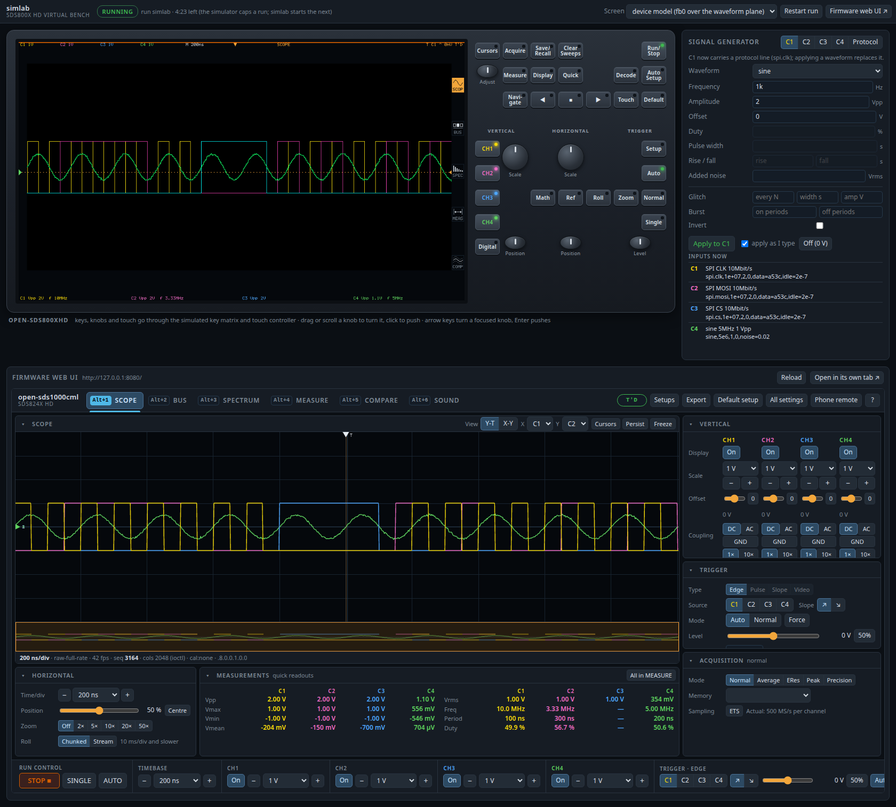

# open-sds800xhd

Open firmware for the Siglent SDS800X HD oscilloscopes (SDS802X HD to SDS824X HD, one acquisition board), built
on [open-dso-core](https://github.com/labeth/open-dso-core), as a member of the
[open-dso](https://github.com/labeth/open-dso) family.

**Stage: simulator; verified in simulation only.** Nothing here has run on an instrument yet; no unit has been on our bench. The
app runs in the tier-1 simulator of a private reference workspace (the unit's kernel modules and boot
scripts under emulation against a model of the board). `specs/` holds the implementable specifications
(00–16, 20) the firmware is written from, in our own words.

See [`SAFETY.txt`](SAFETY.txt) for what the firmware never writes, how to get back to the vendor firmware and
the staged first contact with a unit.

The dedicated hardware frequency counter appears as `Counter Cn` in the native readout bar and web UI.
It is independent of the waveform frequency measurement and remains serviced while acquisition is
stopped or waiting for a trigger. See [counter behavior and calibration limits](docs/counter.md).

## Layout

| Path | What |
|---|---|
| `app/` | Go module `github.com/labeth/open-sds800xhd/app`: the scope app, Go standard library and open-dso-core only |
| `app/cmd/app` | the one device main; the launch hook on p12 starts it (spec 01 §12) |
| `app/internal/` | the hardware code of this scope: register planes (`mmio`), platform and takeover, front end and ADCs, timebase arithmetic, trigger, map engine, acquisition and readout |
| `app/internal/scopeboard` | the board interface of open-dso-core (package `hal`) implemented over those packages; trigger node configurations are the core's `hal.TrigStage` fields and `hal/prototrig` |
| `ota/boot/extra.sh` | the launch hook on p12 that starts the app (spec 01 §12) |
| `app/hdguard` | this unit's policy for open-dso-core's write guard (`fsguard`), which every file, device-node and `/dev/mem` write of the app and of `ota/` goes through: p12's root only, never the boot, kernel, vendor or factory partitions, a U-Boot environment, raw eMMC, eFuses or BBRAM ([`SAFETY.txt`](SAFETY.txt)); the `ota` module imports it from the app module |
| `sim/` | runs the app in the tier-1 simulator of a private reference workspace; `sim/harness` and `sim/cmd/simtest` are the simulator parity harness, `sim/lab` and `sim/cmd/simlab` the virtual bench (module `github.com/labeth/open-sds800xhd/sim`) |
| `app/internal/boardtest` | the in-guest board tests the harness runs (build tag `simboard`) |
| `specs/` | the specifications |
| `model/` | the engineering model (product tier, like open-dso-core's): coarse requirements `REQ-HD-*` per build step realizing the published `CAP-HD-*` capabilities, a unit per package, composing open-dso-core's model; it joins the family model in [open-dso](https://github.com/labeth/open-dso) |

The app takes the unit over from the vendor application, runs the start-up of spec 03 §2, acquires
with the edge trigger, reads every frame out through the AXI DMA, measures it with open-dso-core's
measurements and serves SCPI over VXI-11, the raw socket (port 5025) and telnet (port 5024): the
core's SCPI engine and transports with this scope's dialect (`app/internal/scpi`, built from spec 11
and its appendix tables).

Some product code here is a stand-in for what belongs in open-dso-core (the owner loop and the
instrument state the host handlers edit); it moves there when the core has it.

## Build

The app module requires open-dso-core checked out next to this repository (`../open-dso-core`,
`app/go.mod`'s `replace`).

```sh
make test   # unit tests on the host
make app    # static arm64 binary: build/app
```

## Simulator

`sim/run.sh` runs the app in the tier-1 simulator of the private reference workspace (default
`~/ws/sds800xhd`, override with `SDS800XHD_WS`): the vendor boot up to the kernel modules, then the
launch hook. The app's log ends up in the run's `usr/open/log/app.log`.

```sh
SIMD_ARGS="-signals C1=square,5e6,2,0;C2=sine,1e6,1,0" SCENARIO=sim/scen/host.txt sim/run.sh -n mine -t 45
```

### Parity harness

`make sim-test` builds the app and the in-guest board tests and runs every HAL area in the simulator:
the board tests drive the board through the HAL as the core engine will, and the harness checks what
reached the simulated hardware (register values per case, SPI frames, the framebuffer dump), the
guest's own assertions, SCPI replies, and the start-up registers against a private reference run. It prints
pass/fail per area, mapped onto the CML 1.2 regression areas, and writes `build/sim-test.txt`.
[`docs/parity.md`](docs/parity.md) is the parity table: every item of the SDS1000CML+ 1.2 regression checklist
against what covers it here, the result of a run of every lane and a verdict, with the gaps ranked.

```sh
make sim-test                       # every area (several hours (the decode areas run the longest); selfcal alone takes four)
make sim-test AREA=trigger,readout  # some areas
make sim-test REUSE=1               # re-check the last runs without running the simulator
./build/simtest -list               # the areas
```

### Virtual bench (simlab)

`make simlab` builds the app and starts the simulator with it, then serves a bench page at
<http://127.0.0.1:8090/>; Ctrl-C stops the run and simlab.



- **The scope**: a stylised drawing of the front panel (key layout of spec 08 §2.4) with the live
  screen (the device model's fb0 blended over the waveform plane, or the firmware's own
  `/api/screen.png`). Keys, knobs (drag or scroll to turn, click to push; arrow keys and Enter on a
  focused knob) and clicks on the screen go through the simulated key matrix and touch controller,
  the input path the firmware reads; the key LEDs light from the LED word the firmware writes.
- **Signal generator** per channel C1–C4: sine, square, pulse, triangle, ramp, DC and noise with
  frequency, amplitude, offset, duty, pulse width, rise/fall time, added noise, glitches and bursts;
  and protocol generators (UART, SPI, I²C, CAN with CAN-H/CAN-L, LIN, Manchester) with payload,
  bit rate, levels, idle time and per-protocol options, placed on one or several channels in step
  (clock and data). Changes apply while the scope runs.
- **The firmware's web UI** from the simulator's published port (<http://127.0.0.1:8080/>),
  embedded and as a link.

The simulator caps a run at five minutes and other runs share it: simlab queues for it, starts the
next run when one ends (the simulated p12 and the generator settings carry over) and shows the time
left. `SIMLAB_ARGS="-attach NAME"` follows a run started elsewhere (e.g. `sim/run.sh -n NAME`)
instead; `./build/simlab -h` lists the flags. `make sim-test AREA=lab` is its smoke test.

#### End-to-end suites (simlab-e2e)

`make simlab-e2e` runs browser suites (Node and Playwright, headless Chromium) against simlab: a
simlab already serving on :8090 is used, else one is started for the run. `SUITES=` picks suites,
`REPEAT=N` repeats them; results land in `build/e2e/results.jsonl` and
`node sim/e2e/report.mjs` prints pass rates per suite and step.

| Suite | What it checks |
|---|---|
| `simlab` | the bench page loads and shows the run serving, the screen and the panel; the embedded web UI has the four channels; the generator's form changes C1 and SCPI measures it; CH keys and the V/H-scale knobs change the scope, read back over SCPI, the LCD's UI model, the web UI and fb0; the UART, SPI and I²C presets decode in BUS's packet table; Restart brings a new run that keeps the generator |
| `operator` | the core's operator workflows (`webclient/e2e` in open-dso-core, used as they are) with each bench source made by simlab's generator; `SOURCES=` and `WORKFLOWS=` narrow it |
| `fuzz` | the core's operator fuzzer, bounded (`FUZZ_ITERS`, default 40; seed = repetition) |

The suites wait on state, never on time: a suite starts once simlab reports the run `serving`
(the app answers its web API and SCPI) with enough of its five minutes left, checks before each
step that its run still serves, restarts a run too close to its end, and retries a step a restart
cut on the next run. App findings the suites know of are recorded as seen or not, never failed.
The operator workflows' waits for an observable state are stretched three times
(`E2E_TIME_SCALE`): the app runs under qemu, several times slower than on the unit.

Pass rates on the simulator shared with other runs (host load 4–35 on 8 CPUs, from other
simulator, Verilator and test runs). One suite repetition passes when every step passes;
`report.mjs` gives them per step:

| Suite | Repetitions | Passed | Host load at start |
|---|---|---|---|
| `simlab` | 10 | 10 | 3.8–6.9 |
| `simlab` with four extra busy loops | 3 | 3 | 17.6–30.5 |
| `operator` (`SOURCES=tone1M,maskviol`, the 17 workflows the simulator can make) | 10 | 0 (tone workflows 140/140; M3 5/10, M9 3/10: from a fast timebase the autoset of a low-duty pulse train sometimes ends on one edge) | 12.9–32.2 |
| `fuzz` (40 iterations) | 10 | 10 (0 findings) | 6.9–14.7 |

Load stretches steps (the slowest bench step from 2.0 to 7.8 s at load 24) but failed none; what
remains are app findings, listed with their checks in the suites. The operator workflows the
simulator cannot serve are skipped with the reason: UART, SPI and PRBS (the generator's protocol
frames start idle at the trigger point, so autoset's window around it is flat), and those that
need a feature the HD's caps lack (mask, zones, the pulse trigger).

## Licence

MIT, see [LICENSE](LICENSE).

## Engineering model

`model/` is validated by CI with `engdoc` from
[engineering-model-go](https://github.com/labeth/engineering-model-go) at the release pinned in
`.github/workflows/ci.yml`. It composes open-dso-core's model (alias `core`); until that is published to
a registry it resolves from the core checked out next to this repository, through an `engmod.work.yml`
above both:

```sh
printf 'schemaVersion: 2\nreplacements:\n- module: github.com/labeth/open-dso-core/model@v0\n  path: ./open-dso-core/model\n' > ../engmod.work.yml
cd model
engdoc --model engmod.yml --requirements requirements.yml \
  --design views.yml --code-root .. --lock check --out /tmp/ARCHITECTURE.adoc
```
